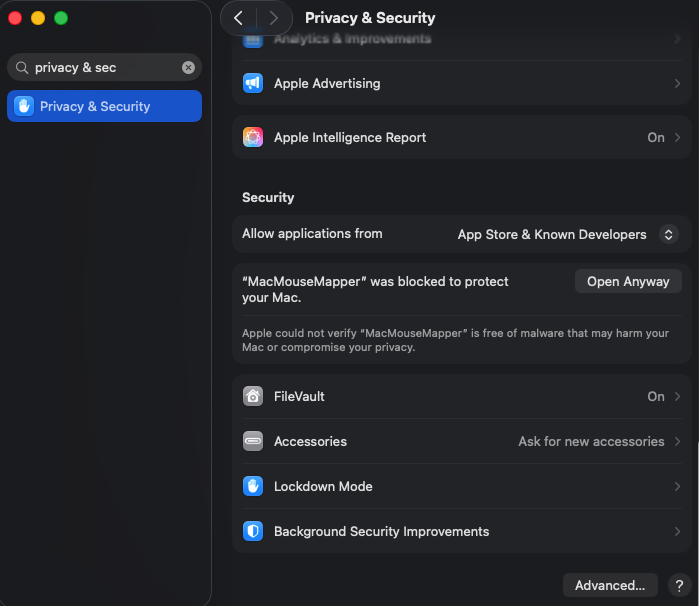

# MacMouseMapper

MacMouseMapper is a native macOS menu-bar app that remaps mouse side buttons 4 and 5 to keyboard shortcuts, other mouse buttons, or scroll-style gestures. Configure one side button at a time: the selected button's default behavior and application-specific behavior stay together, while the other button's saved mappings remain untouched.

## Features

- Button-focused editing with a segmented Mouse Button 4 / Mouse Button 5 selector and a live vector mouse illustration that highlights only the selected side button
- Default behavior and application-specific behavior for the selected button in one compact card
- An illustrated orientation hint plus live **Last side button** detection to identify hardware layouts without assuming every mouse is wired the same way
- A compact, expandable System Access card that keeps recovery controls and diagnostics available when attention is needed
- Keyboard shortcuts, mouse-button actions, and scroll-style gestures
- Pass through any button without remapping it
- Native menu-bar app with no network or analytics

## Requirements

- macOS 13 or later
- A mouse that exposes side buttons 4 and 5

## Installation

1. Download the latest release from [GitHub Releases](https://github.com/arnav-42/MacMouseMapper/releases/latest). The DMG is ad hoc and not notarized.
2. Open the DMG and drag **MacMouseMapper** to **Applications**.
3. The first launch may be blocked by macOS. Open **System Settings → Privacy & Security** and click **Open Anyway** for MacMouseMapper.

   

   The screenshot shows Gatekeeper approval with **Open Anyway**; it is not the separate Accessibility permission.

4. Launch MacMouseMapper. In the app, click **Request Access**, enable MacMouseMapper under **System Settings → Privacy & Security → Accessibility**, and return to the app. After access is granted, the app restarts automatically once.

## Usage

- Use the **Mouse Button 4 / Mouse Button 5** segmented selector to focus one physical side button. The vector mouse illustration highlights the selected button and labels both physical controls.
- The card keeps **Default behavior** (global mapping) beside **Application-specific behavior** for the selected button. Add or select an application without changing the other side button; an empty app-specific mapping uses the default behavior.
- The illustration gives typical rear/lower Button 4 versus front/upper Button 5 guidance, but hardware can vary. Press a side button and check **Last side button** to confirm what macOS reports.
- **System Access** is compact when capture and generated actions are ready. Expand it with the disclosure chevron for status details, diagnostics, recovery actions, and the Accessibility guide whenever attention is needed.
- Choose **Pass through** to leave a physical button unchanged.
- Map a button to a recorded **Keyboard shortcut**, **Another mouse button**, or a **scroll-style gesture** (up, down, left, or right).

## Troubleshooting

- If MacMouseMapper is enabled in Accessibility but the entry is stale, use **Repair Access** in the app.
- If HID posting is denied, mapped buttons pass through instead of being replaced.
- Press each side button and check **Last side button** to verify which button macOS is delivering.
- Because releases are ad hoc, an update may require approving the app again in **Privacy & Security → Open Anyway** and re-enabling Accessibility.

## Build from source

From the repository root:

```sh
./scripts/build_app.sh
open build/MacMouseMapper.app
```

Run the core behavior tests with:

```sh
swift run MacMouseMapperCoreTests
```

## Privacy and limitations

MacMouseMapper has no network access and collects no analytics. Configuration is stored at `~/Library/Application Support/MacMouseMapper/configuration.json`.

It uses public Quartz event APIs. Quartz can post keyboard, mouse, and pixel-scroll events, but does not provide synthetic multitouch contacts; scroll-style gestures therefore depend on how the receiving application interprets them and cannot implement arbitrary trackpad gestures such as pinch or Mission Control.
